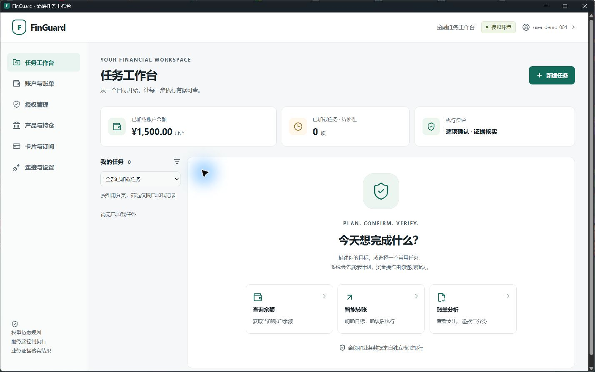
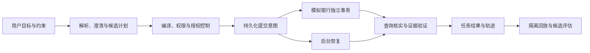

# FinGuard

FinGuard 是一个面向金融任务的工作台与可恢复后端。它把用户目标转换为可校验的计划，在服务端授权范围内执行，并用业务记录、流水和余额证据核实结果。

**当前版本：0.3.0，模拟业务工作台。** 已实现转账、账单、理财申赎、临时锁卡、订阅取消和条件组合任务。前端提供任务计划、逐项确认、结果凭证、业务页面和开发诊断，见[前端入口](frontend/README.md)及[验收记录](docs/frontend-validation.md)。后端包含持久化执行、授权、恢复、轨迹、回放和策略发布流程。DeepSeek 官方 API、自适应规划与有界工具循环见 [Agent 设计](docs/deepseek-design.md)。全部业务使用虚构数据；此前小规模真实模型调用及 Agent 对照结果见 [DeepSeek 验收](docs/deepseek-validation.md)。真实银行和正式身份服务仍待接入。

项目位于公开仓库 [MagDaob/finguard](https://github.com/MagDaob/finguard)。后续开发按可验证的改动持续同步。

已提供 Windows x64 便携桌面版。构建后解压完整软件目录，双击 `FinGuard.exe`，即可自动启动独立窗口和本机模拟服务。使用、数据位置和构建方法见[桌面说明](docs/windows-desktop.md)，实际结果见[桌面验收](docs/windows-desktop-validation.md)。

也可从 [Windows desktop 构建工作流](https://github.com/MagDaob/finguard/actions/workflows/windows-desktop.yml)下载最近通过的运行产物。云端产物保留 14 天，源码与构建入口持续保存在仓库。

交付材料统一保存在 `dist/releases/<版本>/windows-x64/`，包含软件包、使用与版本说明、Apache-2.0 许可、依赖清单及与压缩包绑定的验收结果。整理与验证方法见[发布流程](docs/releasing.md)，当前变化见[变更记录](CHANGELOG.md)，完整导航见[文档索引](docs/README.md)。准备交付材料不表示已经公开发布。



项目本体位于 `src/finguard/`，模拟银行位于独立的 `services/bank-simulator/`。两边分开运行环境、配置、进程、数据库和账号，通过认证 HTTP 接口通信，见[服务隔离说明](docs/service-isolation.md)。

银行、模型和插件的接口准备层已实现，包含标准类型、受信注册入口、模式目录和本地校验 API。它们不激活新连接，也不执行第三方插件，见[扩展接口说明](docs/extension-interfaces.md)。

自然语言入口已补充常见表达、中文金额、完整分句检查和自然月账单，支持显式关联前一任务查询最新余额。高金额操作需要额外验证；验证服务尚未接入时阻止执行。任务文字和导出应用有限脱敏规则，见[自然语言与隐私说明](docs/understanding-and-privacy.md)。

当前任务入口已改为[连续对话与自动任务登记](docs/conversations.md)：支持任务表、查询自动执行、对话内确认、金额修订及刷新后读取历史。2026 年 10 月 29 日本机桌面候选已更新至 `dist/releases/0.3.0/windows-x64-20261029/`，实际 EXE 和附件验证见[发布准备记录](docs/release-preparation-validation.md)；尚未公开发布。

## 设计与能力

系统显式关联任务、计划、授权、操作和证据。模型只能提出候选计划，确定性程序负责权限、参数、依赖、限额和业务规则。



| 能力 | 当前行为 |
|---|---|
| 转账 | 整数分金额、人民币、确认收款人、最低保留余额、并发扣款和稳定操作编号 |
| 账单 | 已入账现金流统计，分别返回支出、退款、净支出和分类；排除内部转账与理财流动 |
| 理财 | 固定价值模拟产品，检查风险和交易窗口；赎回受理与到账分开，到账后才解锁后续步骤 |
| 服务管理 | 临时锁卡与恢复；订阅合同取消，明确代扣授权未变更、退款为零 |
| 授权 | 服务端访问令牌、单次参数授权、受限转账委托、累计预算、频次、到期与撤销 |
| 任务 | 依赖图、计划版本、澄清、局部重规划、部分完成、停止和重新授权 |
| 可靠执行 | 提交意图持久化、未知结果核实、重复回调处理、重启恢复和证据校验 |
| 调试与改进 | 轨迹、报告导出、故障回放、失败归因、候选生成、对照评估、审核发布与回退 |

## 本机启动

需要 Python 3.12 至 3.14 和 [uv](https://docs.astral.sh/uv/getting-started/installation/)。默认 Python 为 3.14，依赖由 `uv.lock` 固定。以下 PowerShell 命令在项目根目录执行。

安装依赖：

```powershell
uv sync --locked --group dev
```

Windows 本机 PostgreSQL：

```powershell
.\scripts\local-postgres.ps1 start -Download
.\scripts\local-services.ps1 stop
uv run --locked python scripts/isolate-local.py
.\scripts\sync-services.ps1
uv run --locked finguard seed-demo
```

首次运行会下载经过 SHA-256 校验的 PostgreSQL 18.6 二进制包，建立隔离数据目录和随机密码。数据、端口和日志位于忽略的 `artifacts/postgresql/`。脚本仅监听本机地址，已有 `.env` 保留。使用自行安装的数据库时，按 [.env.example](.env.example) 配置 `.env`，跳过下载脚本。

启动独立模拟银行、项目接口和内置恢复任务：

```powershell
.\scripts\local-services.ps1 start
```

打开 [API 文档](http://127.0.0.1:8000/docs)；[就绪检查](http://127.0.0.1:8000/health/ready)应返回 `ready`。演示访问令牌保存在本地 `artifacts/demo-tokens.local.json`，有效期为 24 小时。到期后执行 `seed-demo --rotate`；旧令牌如未撤销，会按原期限到期。

安装 Node.js 24.12.0 后，构建前端：

```powershell
Set-Location frontend
npm ci
npm run build
Set-Location ..
.\scripts\local-services.ps1 stop
.\scripts\local-services.ps1 start
```

打开[任务工作台](http://127.0.0.1:8000/tasks)，输入本机演示访问令牌。令牌只保存在页面内存中，刷新后需重新输入。开发模式和独立前端容器见[前端说明](frontend/README.md)。工作台的新任务会使用后端当前配置的模型；配置付费模型时可能产生调用费用。

在另一终端运行模拟转账：

```powershell
$fgTokens = Get-Content artifacts/demo-tokens.local.json -Raw | ConvertFrom-Json
$fgHeaders = @{ Authorization = "Bearer $($fgTokens.user.token)" }
$fgBody = @{ client_request_ref = "demo-$([guid]::NewGuid().ToString('N'))"; user_request = "给小王转300元，至少保留1000元" } | ConvertTo-Json
$fgTask = Invoke-RestMethod http://127.0.0.1:8000/v1/tasks -Method Post -Headers $fgHeaders -ContentType 'application/json; charset=utf-8' -Body ([Text.Encoding]::UTF8.GetBytes($fgBody))
$fgOperation = $fgTask.operations[0]
$fgApproval = @{ expected_digest = $fgOperation.digest } | ConvertTo-Json
Invoke-RestMethod "http://127.0.0.1:8000/v1/operations/$($fgOperation.operation_ref)/approvals" -Method Post -Headers $fgHeaders -ContentType application/json -Body $fgApproval | Out-Null
$fgResult = Invoke-RestMethod "http://127.0.0.1:8000/v1/tasks/$($fgTask.task_ref)/run" -Method Post -Headers $fgHeaders
$fgResult | Select-Object status, verified_success
```

新建演示库的初始余额为 1,500 元。首次转账后余额为 1,200 元，任务返回 `COMPLETED`、`verified_success: true`。演示库保留历史，多次执行会继续消耗余额；`seed-demo` 不重置已有交易。更多接口与约束见 [API 使用说明](docs/api.md)。

## 验证

```powershell
uv run --locked ruff check .
uv run --locked ruff format --check .
uv run --locked pytest -q
uv run --locked finguard replay --suite tests/scenarios/backend-replay.json
uv build --all --no-sources --out-dir dist/python/0.3.0
```

数据库测试使用随机命名空间，结束后仅清理本次命名空间。未配置数据库时，相关测试会跳过；设置 `FINGUARD_REQUIRE_POSTGRES=1` 可要求数据库检查必须执行。纯单元测试使用 `pytest -m "not postgres"`。

回放报告写入 `artifacts/replay-report.json`，独立检查授权、参数绑定、账本、重复记账、归属和证据。固定输出回放与模型回放分别报告，合法任务完成率与正确处理率分别计算。验证入口和实际记录见[测试说明](tests/README.md)及[后端验收记录](docs/backend-validation.md)。

## 部署与文档

容器启动配置见 [compose.yml](compose.yml)和 [Dockerfile](Dockerfile)。数据库备份、独立恢复进程、模型网关协议、跨域设置及故障处理见[后端运行说明](docs/backend.md)。

| 路径 | 内容 |
|---|---|
| [src/finguard/backend/](src/finguard/backend/) | 项目接口、存储、执行控制、规划、银行客户端与评估入口 |
| [frontend/](frontend/) | React 工作台、接口校验、组件测试与独立容器 |
| [packaging/windows/](packaging/windows/) | Windows 桌面入口、独立构建环境、图标和冻结入口 |
| [services/bank-simulator/](services/bank-simulator/) | 独立模拟银行、账本、业务数据、故障与离线回放 |
| [packages/bank-contracts/](packages/bank-contracts/) | 双方共享的参数、摘要与错误契约 |
| [src/finguard/domain/](src/finguard/domain/) | 金额、引用、核心对象及状态迁移守卫 |
| [src/README.md](src/README.md) | 源码职责索引 |
| [docs/architecture.md](docs/architecture.md) | 数据流、事务和信任边界 |
| [docs/domain-model.md](docs/domain-model.md) | 核心对象、状态和持久化关联 |
| [docs/decisions.md](docs/decisions.md) | 已采用的选型与代价 |
| [docs/roadmap.md](docs/roadmap.md)、[docs/implementation-plan.md](docs/implementation-plan.md) | 当前阶段与剩余工作 |
| [docs/frontend-design.md](docs/frontend-design.md)、[docs/frontend-validation.md](docs/frontend-validation.md) | 前端设计、实现范围、验证和剩余接口 |
| [docs/frontend-redesign.md](docs/frontend-redesign.md) | 新版对话式任务与成果面板设计；Geometric Bold 风格，已应用前端源码 |
| [docs/integration-platform-plan.md](docs/integration-platform-plan.md) | 接口准备的范围与实施阶段 |
| [docs/extension-interfaces.md](docs/extension-interfaces.md) | 已实现契约、本地校验 API 与开发说明 |
| [docs/understanding-and-privacy.md](docs/understanding-and-privacy.md) | 输入完整性、账单区间、关联追问、分级验证与脱敏 |
| [tests/backend/](tests/backend/) | PostgreSQL、并发、授权、恢复、HTTP 和优化流程测试 |
| [docs/sources/project-framework.txt](docs/sources/project-framework.txt) | 用户提供的完整框架原文 |

## 使用边界

自然语言基线只解析明确的有限表达；歧义、否定或尚未支持的条件进入澄清，可通过结构化计划补充。DeepSeek 官方接口和自定义模型网关可提供候选编排，不能修改业务目标和关键参数，也不能签发授权。

金额只支持人民币整数分，模拟报价费用为零。理财没有净值波动、收益计算或真实交易日历。卡片只支持临时锁定，订阅取消不撤销代扣协议。转账没有自动反向付款；卡片补偿需创建新任务并重新授权。

本版本用于开发、集成和模拟验收。真实服务必须重新验证其幂等、查询、回调和授权机制。正式登录、额外身份验证、连接激活和插件执行尚未实现。项目采用 [Apache-2.0](LICENSE)，项目声明见 [NOTICE](NOTICE)；第三方组件分别保留其许可。
