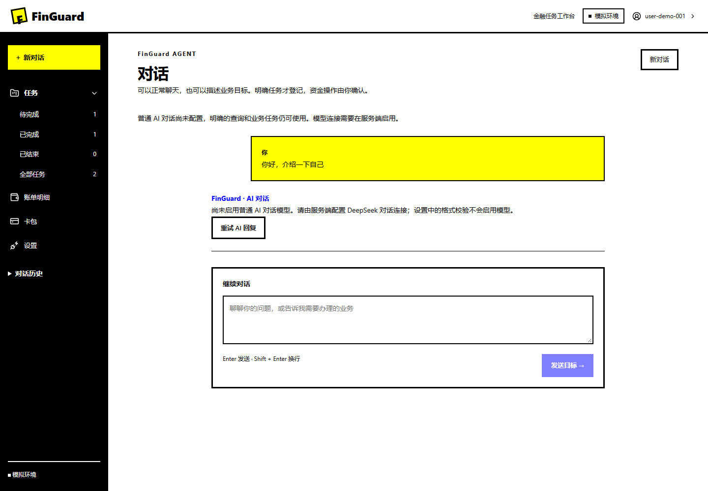
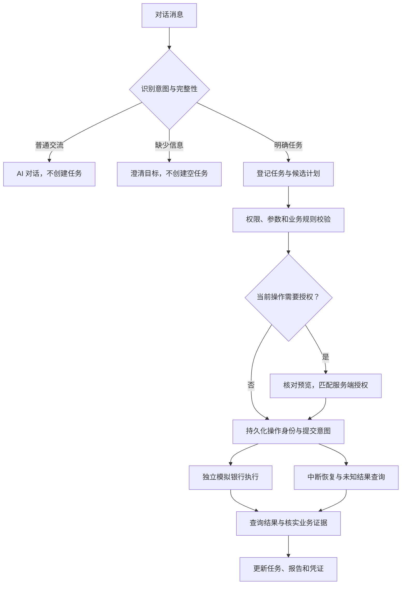

<div align="center">

<h1>FinGuard</h1>

<p><strong>用对话描述金融目标，让每一步执行都有依据。</strong></p>

<p>对话式金融智能体工作台 · 受控执行 · 结果核实 · Windows / Web</p>

[快速开始](#快速开始) · [功能与界面](#功能与界面) · [执行机制](#执行机制) · [开发与验证](#开发与验证) · [项目文档](#项目文档)

</div>

FinGuard 面向金融智能体的开发与模拟验证。你可以在对话中描述目标，查看系统识别的任务和执行计划，再确认资金操作。系统通过业务记录、流水和余额证据核实结果，保留可追溯的任务与执行过程。

**当前版本为 0.3.0 模拟业务候选。** 已提供 React 工作台、独立后端和 Windows x64 便携版。全部银行业务使用虚构账户与数据；真实银行、正式身份服务和第三方插件运行尚未接入。



> 截图来自项目的隔离模拟验收。桌面包默认关闭付费模型，普通聊天会明确显示未配置状态；服务端配置 DeepSeek 后可启用真实 AI 对话。

## 功能与界面

工作台采用黑白、纯蓝与亮黄的 Geometric Bold 风格。以对话为主入口，按需打开任务、报告与凭证，减少页面切换。

| 入口 | 当前可用能力 |
|---|---|
| 对话 | 普通聊天、目标澄清、任务识别；明确任务才登记，信息不足时先询问；会话与消息持久化 |
| 任务 | 下拉展开待完成、已完成、已结束和全部任务；查看计划、状态、确认卡及业务证据 |
| 账单明细 | 查询账单，区分支出、退款、净支出与分类；支持自然月区间 |
| 卡包 | 从银行下拉目录选择、连接、导入账户与卡片、同步和移除；目前提供 FinGuard 模拟银行 |
| 设置 | AI、银行与插件接口格式校验；大字号、紧凑布局和减少动效等偏好可在浏览器保存 |

**接口校验与连接生效分别处理。** 设置页目前不保存或激活模型密钥及第三方插件。AI 对话通过服务端环境配置启用，具体方法见[对话与任务分流](docs/conversations.md)。

支持的模拟业务包括转账、账单查询、理财申购与赎回、临时锁卡与恢复、订阅合同取消及条件组合任务。查询任务自动推进；资金操作展示确认卡，并在服务端授权范围内执行。

<details>
<summary>查看卡包与任务确认界面</summary>

银行选择与资产导入，使用虚构账户及卡片：


任务对话中的金额修订与确认卡。该截图记录任务分类菜单改版前的交互验收：


</details>

## 快速开始

### 使用 Windows 桌面版

目标环境为 Windows 10 1903 及之后版本、Windows 11 的 x64 环境，需要系统具备 Microsoft Edge WebView2 Runtime。便携包自带业务服务和数据库，无需另装 Python、Node.js 或 PostgreSQL。

1. 打开 [Windows desktop 构建工作流](https://github.com/MagDaob/finguard/actions/workflows/windows-desktop.yml)，选择成功运行，在 Artifacts 下载 `FinGuard-windows-x64`。下载 Actions 产物需要登录 GitHub；产物保留 14 天。
2. 解压下载的附件，再解压其中的 `FinGuard-0.3.0-windows-x64.zip`，保留完整 `FinGuard/` 目录。
3. 双击 `FinGuard.exe`，等待本机服务启动，点击“进入本机工作台”。
4. 在新对话中输入“查询当前余额”，或尝试“给小王转 300 元，至少保留 1000 元”。资金操作需核对并确认。

若没有可用的 Actions 附件，可按[桌面构建说明](docs/windows-desktop.md#从源码构建)自行构建。默认数据保存在 `%LOCALAPPDATA%\FinGuard`；关闭和重启软件会保留历史，重新解压程序不会重置数据。

最新本机候选构建于 **2026 年 10 月 29 日**，已包含新版界面、任务分类、对话分流和卡包导入。实际 EXE 的 10 项自检及附件校验通过，见[发布验收记录](docs/release-preparation-validation.md#2026-年-10-月-29-日新版候选)。该结果仅对应记录中的构建与摘要；Actions 的独立构建以各自产物记录为准。目前便携包未签名，尚未创建公开 GitHub Release。

### 从源码运行

需要 Python 3.12 至 3.14、uv 和 Node.js 24.12.0。以下为 Windows PowerShell 命令，在项目根目录执行。其他部署方式见[后端运行说明](docs/backend.md)及 [compose.yml](compose.yml)。

取得源码并安装依赖：

```powershell
git clone https://github.com/MagDaob/finguard.git
Set-Location finguard
uv sync --locked --group dev
```

准备本机数据库、隔离服务与演示数据：

```powershell
.\scripts\local-postgres.ps1 start -Download
.\scripts\local-services.ps1 stop
uv run --locked python scripts/isolate-local.py
.\scripts\sync-services.ps1
uv run --locked finguard seed-demo
```

首次运行会下载并校验 PostgreSQL 18.6，建立本机数据目录和随机密码。使用已有数据库时，按 [.env.example](.env.example) 配置并跳过下载。已有 `.env` 会保留，演示数据不会被重复初始化覆盖。

构建前端并启动服务：

```powershell
Set-Location frontend
npm ci
npm run build
Set-Location ..
.\scripts\local-services.ps1 start
```

打开 [Web 工作台](http://127.0.0.1:8000/tasks)，输入 `artifacts/demo-tokens.local.json` 中的用户访问令牌。浏览器令牌只保存在页面内存中，刷新后需重新输入。[就绪检查](http://127.0.0.1:8000/health/ready)应返回 `ready`，[API 文档](http://127.0.0.1:8000/docs)提供接口入口。

演示令牌有效期为 24 小时，到期后执行 `uv run --locked finguard seed-demo --rotate`。新建演示库初始余额为 1,500 元；上述 300 元转账经有效确认后，余额为 1,200 元，并产生可核实的业务证据。已有库保留交易，多次操作会继续改变余额。

前端开发模式见[前端说明](frontend/README.md)，模型配置见[对话说明](docs/conversations.md#普通-ai-对话)和 [Agent 设计](docs/deepseek-design.md)。源码服务若启用付费模型，聊天与规划可能产生调用费用。

## 执行机制

模型负责理解目标并提出候选计划，确定性控制程序负责权限、参数、依赖、限额和业务规则。任务、计划、授权、操作与证据之间保持显式关联。



- **授权与模型隔离。** 模型输出不能生成有效授权；聊天里的“好”不能代替付款确认。关键参数变化后重新核对授权。
- **重试沿用操作身份。** 未知结果先查询；重启、恢复或重规划不直接重复提交付款。已完成操作保留为事实。
- **证据决定完成状态。** 不能只凭模型文本或任务状态报告业务成功。已完成分类要求当前计划操作成功并具备对应证据。
- **服务分别隔离。** 项目与模拟银行分开运行环境、进程、配置及数据库账号，通过认证 HTTP 接口通信；读操作同样经过控制边界。

细节见[架构](docs/architecture.md)、[领域模型](docs/domain-model.md)和[服务隔离](docs/service-isolation.md)。

## 开发与验证

前端采用 React、TypeScript、Vite、React Router、TanStack Query、Zod 与无损 JSON 解析。后端采用 Python、FastAPI、Pydantic、PostgreSQL、Psycopg 和 HTTPX；uv 锁定依赖。Windows 外壳使用 pywebview 与 PyInstaller，独立冻结桌面、后端和模拟银行。

| 目录 | 职责 |
|---|---|
| [frontend/](frontend/) | 对话工作台、业务页面、接口校验与组件检查 |
| [src/finguard/](src/finguard/) | 领域对象、规划、授权、执行、恢复和评估 |
| [services/bank-simulator/](services/bank-simulator/) | 独立模拟银行、账户、账本与业务证据 |
| [packages/](packages/) | 银行与插件的共享契约 |
| [packaging/windows/](packaging/windows/) | 桌面入口、独立构建环境和冻结配置 |
| [scripts/](scripts/) | 本机服务、隔离联调、构建与交付核验 |
| [tests/](tests/) | 单元、数据库、并发、授权、恢复和回放检查 |
| [docs/](docs/) | 使用、设计、验收、版本与开发路线 |

后端检查在项目根目录运行：

```powershell
uv run --locked ruff check .
uv run --locked ruff format --check .
uv run --locked pytest -q
uv run --locked finguard replay --suite tests/scenarios/backend-replay.json
```

前端检查：

```powershell
Set-Location frontend
npm run format:check
npm test
npm run build
```

数据库测试采用随机命名空间，结束后只清理本次数据。未配置数据库时，相关测试会跳过；设置 `FINGUARD_REQUIRE_POSTGRES=1` 可要求必须执行。纯单元检查使用 `pytest -m "not postgres"`。

最近一次 Windows 候选准备记录包含 27 项发布与桌面检查、37 项前端检查、生产构建，以及实际 EXE 的 10 项自检。该轮使用虚构数据，付费模型调用为零。它验证模拟闭环，不代表真实银行或生产环境验收。完整方法和历史结果见[测试入口](tests/README.md)、[前端验收](docs/frontend-validation.md)及[发布验收](docs/release-preparation-validation.md)。

## 项目文档

| 主题 | 入口 |
|---|---|
| 使用与交付 | [桌面使用](docs/windows-desktop.md) · [发布流程](docs/releasing.md) · [0.3.0 版本说明](docs/releases/0.3.0.md) · [变更记录](CHANGELOG.md) |
| 对话与界面 | [对话与任务分流](docs/conversations.md) · [卡包银行接入](docs/wallet-bank-connections.md) · [前端改版设计](docs/frontend-redesign.md) |
| 接口与部署 | [API 使用](docs/api.md) · [后端运行](docs/backend.md) · [模型规划](docs/deepseek-design.md) · [扩展契约](docs/extension-interfaces.md) |
| 设计与进度 | [架构](docs/architecture.md) · [设计决策](docs/decisions.md) · [开发路线](docs/roadmap.md) · [完整文档索引](docs/README.md) |

## 使用边界与许可

- 目前实际连接 FinGuard 模拟银行。真实银行 OAuth、外部 MCP（模型上下文协议）适配和多银行业务路由仍待接入。
- 普通聊天可在服务端启用 DeepSeek，确定性规划器只识别有限的明确表达。开放任务理解与模型质量仍需独立评估。
- 金额使用人民币整数分。模拟理财没有净值波动、收益计算或真实交易日历；赎回受理与到账分别处理。
- 卡片支持临时锁定与恢复。取消订阅只作用于合同，不撤销代扣授权，模拟退款为零。转账不提供自动反向付款。
- 正式登录、额外身份验证、桌面模型密钥管理、第三方插件执行、自动升级及跨电脑数据迁移尚未实现。高金额所需的额外验证不可用时，系统阻止执行。

问题反馈请使用 [GitHub Issues](https://github.com/MagDaob/finguard/issues)，附上复现步骤与脱敏信息；不要上传密钥、访问令牌或个人金融数据。

项目采用 [Apache-2.0](LICENSE)，声明见 [NOTICE](NOTICE)。第三方组件保留各自许可。界面结构参考 LibreChat，视觉参考 Geometric Bold，来源与取舍见[设计说明](docs/frontend-redesign.md#结构选择与调研依据)。
