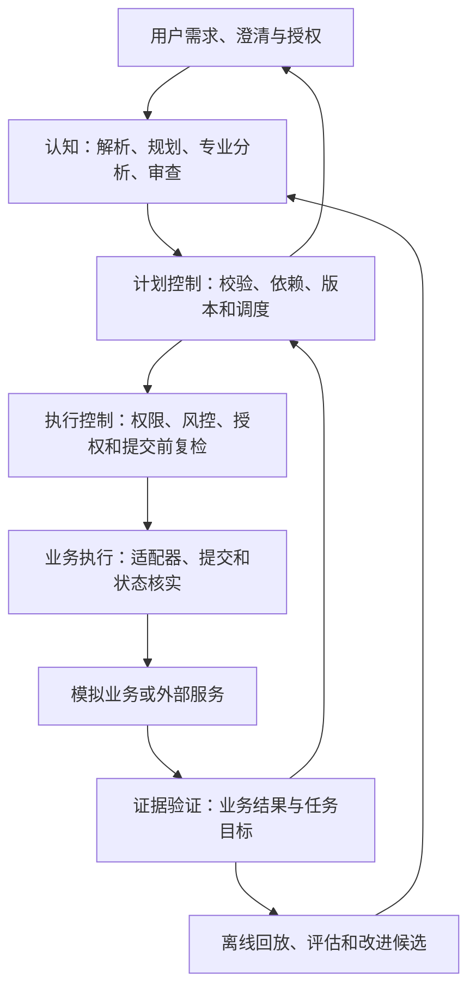

# 系统架构

本文整理用户提供的[项目框架](sources/project-framework.txt)。0.2.0 已实现模拟业务后端；真实服务与前端单独接入。运行入口见 [后端说明](backend.md)，接口见 [API 说明](api.md)。

## 目标与边界

系统需要理解金融任务，生成动态计划，并在明确授权内执行。执行结果由业务证据验证，失败记录进入调试与离线改进流程。

认知、控制和执行承担不同职责。PostgreSQL 提供持久化与协调，FastAPI 提供服务入口。确定性解析器、可选模型网关和计划编译器承担认知职责，业务计算与风险规则由专业工具执行。当前没有独立多智能体进程。

## 模块职责

| 模块 | 主要职责 | 边界 |
|---|---|---|
| 领域模型 | 表达任务、计划、授权、操作和证据 | 不依赖对话记录推断业务事实 |
| 认知系统 | 意图解析、主规划、专业分析和计划审查 | 仅提交候选方案，不直接放行业务 |
| 计划控制 | 结构校验、语义审查、依赖调度和局部重规划 | 保留已完成事实和历史计划版本 |
| 执行控制 | 数据范围、业务约束、授权和限额校验 | 覆盖全部工具调用 |
| 执行内核 | 稳定操作身份、持久化状态和故障恢复 | 核实未知结果，防止恢复时重复执行 |
| 业务适配器 | 封装下游接口及其真实业务语义 | 明确幂等、查询、超时和补偿能力 |
| 证据验证 | 核实操作结果及任务成功条件 | 工具返回成功不自动等于目标完成 |
| 可观测与评估 | 任务轨迹、回放、故障注入和指标比较 | 脱敏记录结构化摘要，不依赖隐藏推理 |

## 计划编译

候选计划须转换为程序可校验的结构。节点应包含操作、参数、依赖、约束、成功条件和失败策略。

工具注册表描述参数、返回值、访问范围、副作用、授权要求、幂等能力、查询能力、超时语义及补偿条件。三类校验各有职责：

- 结构校验：工具存在、参数有效、依赖无环。
- 语义校验：计划覆盖用户条件，歧义进入澄清。
- 业务校验：资源可用、业务支持、资金及限额满足条件。

模型可辅助语义审查。权限、资金和授权等明确规则由程序判断。

## 执行链路

| 阶段 | 产物或检查 |
|---|---|
| Prepare（准备） | 解析资源，形成操作草案 |
| Validate（校验） | 检查参数、前置条件、业务约束和权限 |
| Authorize（授权） | 获取并保存适用的单次授权或受限委托 |
| Commit（提交） | 复检关键条件，持久化提交意图，调用适配器 |
| Reconcile（核实） | 查询或接收业务结果，处理未知状态 |
| Verify（验证） | 核对证据与操作、任务成功条件 |
| Report（报告） | 依据证据说明完成、失败或仍待核实的部分 |

准备阶段不冻结资金。应用事务先保存提交意图与授权消费，再调用模拟银行的独立事务；最后查询权威记录并保存证据。两次提交之间的故障通过原操作编号核实。

## 授权与停止

单次授权绑定具体操作。受限委托需明确对象白名单、单笔上限、累计限额、频次、期限和撤销方式。

可信执行组件验证授权主体、操作范围、关键参数、有效期和使用状态。授权消费采用行锁与原子预算更新；模拟银行在账户锁内复检最低余额及业务条件。到期检查使用实际时间，防止锁等待沿用过期授权。

停止任务时，未提交操作停止调度；已提交操作继续核实。已完成操作依据业务能力决定能否撤销。补偿属于新的业务操作，可能需要费用和新授权。

## 扩展与恢复

数据依赖与业务条件依赖分开表达。“赎回到账后转账”需要资金实际可用，申请受理并不满足该条件。

超时后先核实原操作。下游不支持稳定交易标识、幂等键或状态查询时，须明确可提供的保证和人工处置路径。

主规划器与专业角色属于逻辑职责，可以共享模型。确定性计算直接由工具处理。模型之间达成一致不能替代程序控制。

## 当前代码与事务边界

| 位置 | 实现 |
|---|---|
| `backend/api.py` | 认证、请求限制、业务查询、任务与运营入口 |
| `backend/catalog.py`、`backend/planning.py` | 工具模式、目标归一化、有限解析、候选计划和编译 |
| `backend/service.py` | 计划版本、调度、提交意图、停止、核实及任务汇总 |
| `backend/security.py`、`backend/authorization.py` | 主体权限、单次授权、委托消费与失败释放 |
| `backend/bank.py` | 独立业务事务、模拟账本、幂等结果、延迟结算和证据 |
| `backend/database.py`、`backend/migrations/` | PostgreSQL 命名空间、迁移和任务锁 |
| `backend/evaluation.py`、`backend/policies.py` | 隔离回放、系统不变量、失败归因和提示词发布 |

任务会话锁覆盖一次调度及外部调用，应用事务不跨银行调用持有。停止请求使用行锁取消未提交操作；已经提交的操作继续核实。多个恢复进程共享同一操作身份，不能重新生成同义付款。

模拟银行采用稳定操作编号、参数摘要和唯一流水约束。查询可以为不存在的操作写入失败栅栏，从而阻止迟到提交。真实下游不一定支持此能力，不能仅因查询未找到就判定付款失败。

成功操作关联权威业务记录；金融操作额外核对流水金额与余额快照。计划完成需要当前全部节点成功且存在证据。数据库故障、响应丢失、结构异常或证据缺失均不能生成成功结论。
