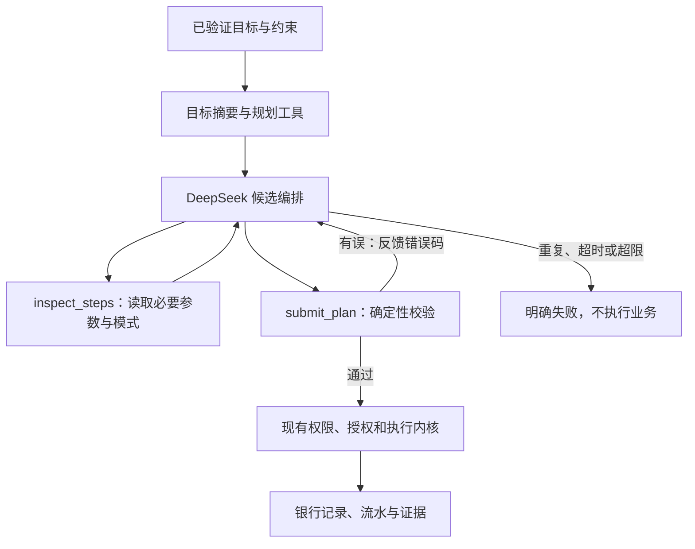

# DeepSeek Agent 设计

适用版本：0.3.0。资料核对日期：2026 年 10 月 27 日。本次将 DeepSeek 官方接口接入已有控制内核，并增加可终止、可观测的候选规划循环。

## 查阅依据

- [DeepSeek 官方接入说明](https://api-docs.deepseek.com/)：官方地址、当前模型标识和认证方式。
- [Chat Completions API](https://api-docs.deepseek.com/api/create-chat-completion/)：消息、工具调用、输出结束原因和用量字段。
- [思考模式](https://api-docs.deepseek.com/guides/thinking_mode/)：工具循环中的推理字段透传。
- [工具调用](https://api-docs.deepseek.com/guides/tool_calls/)及[并发限制](https://api-docs.deepseek.com/quick_start/rate_limit/)：客户端与服务端的职责边界。
- [DSH-OPS 源仓库](https://github.com/T-Auto/dsh-ops)：按需加载工具及紧凑反馈的设计。
- [DSH-OPS PTC 说明](https://github.com/T-Auto/dsh-ops/blob/main/docs/native-ptc.md)：有界结果、明确状态和观察引用的权限边界。

DSH-OPS 属于社区项目。本项目参考其设计，自行实现 Python 调度和金融控制；没有安装该插件，也没有把外部 Shell 工具开放给金融 Agent。

## 改进内容

| 方向 | 本次实现 | 验证方法 |
|---|---|---|
| 按需模式 | 初始只发送目标摘要和两个规划工具；完整参数与相关业务模式按目标查询 | 记录提示 Token，对照全量模式方案 |
| 有界结果 | 每次最多查询 8 个目标，单次工具结果最多 32 KiB | 模式校验、大小检查及错误反馈 |
| 明确反馈 | 工具返回 `completed` 或 `rejected`，包含错误码及下一步要求 | 错误候选修正测试 |
| 防止空转 | 默认最多 4 轮，每轮最多 8 个工具调用；拒绝重复调用及重复调用编号 | 重复调用、无效工具、轮次上限测试 |
| 网络复用 | 共享 HTTPX 客户端和连接池，并发默认上限 4 | 并发测试及真实 API 分级测试 |
| 结果可观测 | 记录轮次、耗时、模型、Token 用量和工具状态 | 任务轨迹与独立测试报告 |

这些是实现层面的改动。节省多少 Token、是否降低延迟，要由同一模型和场景的实测回答，不能引用其他项目的宣传数据作为本项目结果。

## 执行循环



`inspect_steps` 只读取本次调用中已经经过权限与资源检查的目标，不访问新业务资源。`submit_plan` 只提交候选。工具结果与计划引用都不能生成授权。

编译器要求保留全部目标、动作、完整参数及必要依赖。模型无法增加付款、修改金额、取消资金到账条件或签发授权。业务执行继续复用原操作编号；未知付款先核实，成功仍需要业务证据。

自然语言理解继续使用有限解析器，模型负责结构化目标的候选编排。更广泛的开放文本理解需要另行建立确认规则和评估集。

## DeepSeek 适配

当前官方模型标识使用 `deepseek-flash`，也可配置 `deepseek-v4-pro`。接口固定为 `https://api.deepseek.com/chat/completions`，密钥不会发送给自定义网关地址。模型别名对应的服务版本可能变化，因此报告同时保留请求模型和响应模型。[官方模型入口](https://api-docs.deepseek.com/)

默认关闭思考模式，显式限制输出，便于先验证工具流程。启用思考模式时保留历史 `reasoning_content`，仅在同一次调用链内透传。该字段不进入任务轨迹、评估报告或日志。思考模式使用自动工具选择，非思考模式要求工具调用。[官方思考模式说明](https://api-docs.deepseek.com/guides/thinking_mode/)

每次规划生成随机 `user_id`，同一工具循环内复用，跨规划不共用。不发送真实姓名、访问令牌或个人身份字段。该隔离取舍可能降低跨规划缓存复用，测试报告保留实际缓存用量。[官方隔离说明](https://api-docs.deepseek.com/quick_start/rate_limit/)

本次未启用 Beta strict 模式，所有参数继续由 Pydantic 和计划编译器校验。401、402、429、超时、响应截断和非法 JSON 均转换为明确错误码，不回显上游响应体或密钥，不自动重发请求。

## 本机配置

在项目根目录的 `.env` 中设置以下字段。真实密钥只能写入本机忽略文件或环境变量，示例中的说明文字需要替换。

```dotenv
FINGUARD_MODEL_PROVIDER=deepseek
FINGUARD_DEEPSEEK_API_KEY=填写你的本机密钥
FINGUARD_DEEPSEEK_MODEL=deepseek-flash
FINGUARD_DEEPSEEK_THINKING=false
FINGUARD_DEEPSEEK_MAX_TOKENS=2048
FINGUARD_DEEPSEEK_MAX_ROUNDS=4
FINGUARD_DEEPSEEK_CONCURRENCY=4
```

也支持 `DEEPSEEK_API_KEY`。`FINGUARD_DEEPSEEK_API_KEY` 优先。其余可选配置见 [.env.example](../.env.example)。配置修改后重启服务：

```powershell
uv run --locked finguard serve
```

`FINGUARD_MODEL_PROVIDER=deterministic` 使用本地基线。原有 `FINGUARD_MODEL_URL` 自定义网关继续兼容，DeepSeek 官方接口不要求搭建额外中转服务。

## 真实测试协议

```powershell
uv run --locked finguard model-benchmark --live
```

该命令执行真实付费模型请求，业务始终使用隔离的虚构数据。固定最多 32 次网络请求，并发最高 4，输出最多 2048 Token；探测和吞吐请求只输出少量文本。不会自动增加并发或重试。

1. 先做 1 次连接探测。认证、余额或网络错误时结束，不继续压测。
2. 按并发 1、2、4 依次执行 4、4、8 个短请求，记录成功数、错误码、端到端延迟、请求吞吐及输出 Token 吞吐。
3. 使用同一套件前三个场景，分别运行全量模式单次计划基线和按需工具循环。场景包含成功转账、等待授权及响应丢失后恢复。
4. 基线每个场景最多 1 次请求，工具循环每个场景最多 4 次。最坏请求数为 `1 + 16 + 3 + 3 × 4 = 32`。
5. 每个业务场景创建独立命名空间，检查账本、授权、重复记账、归属及证据，结束后清理该命名空间。

报告默认写入 `artifacts/deepseek-live-report.json`，不进入仓库。用量和延迟按每次请求保存；思考内容和密钥不保存。基线先运行、工具循环后运行，可能存在缓存与时间顺序影响。样本很小，只用于集成和初步对照，不能推算服务商容量，也不测流式首 Token 延迟。

普通 pytest 与 CI 只使用模拟 HTTP 响应，不调用付费 API。真实执行状态及可公开摘要见 [DeepSeek 验收记录](deepseek-validation.md)。
