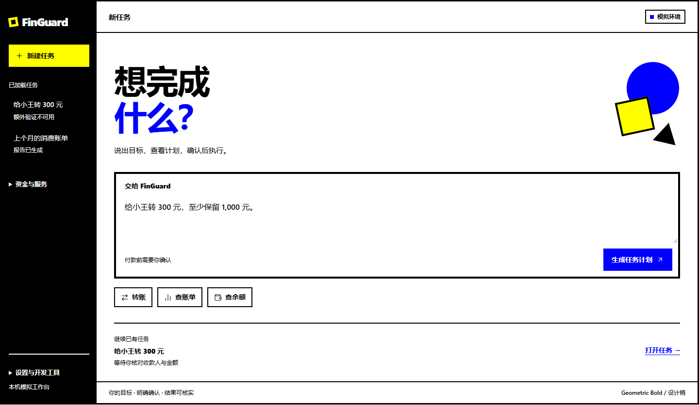
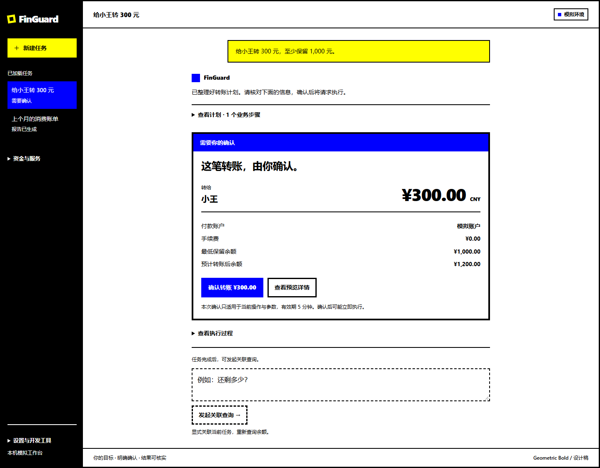
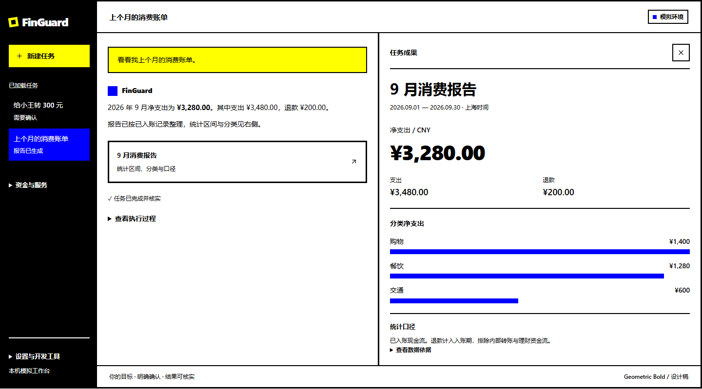

# 前端改版设计：对话式任务与成果面板

日期：2026 年 10 月 29 日。项目基线：`3a9cc55`。状态：已应用到前端源码；Windows 桌面发布包尚未重新构建。

本方案选择 LibreChat 的界面组织方式，并采用用户指定的 Geometric Bold 视觉风格。它替代[首版方案](frontend-design.md)中的主导航、常驻三栏及浅色低饱和视觉设计。现有授权、金额、恢复和证据约束继续有效。

## 结构选择与调研依据

选定结构为“任务历史侧栏 + 对话式任务主区 + 按需打开的成果面板”。默认只有侧栏和主区。用户查看账单或凭证时，再打开成果面板。

本次查阅了公开仓库、官方产品说明及相关组件。以下是界面形态对照，不是性能评测，也不代表已部署这些产品。

| 参考项目 | 已核实的产品形态 | 对 FinGuard 的适用判断 |
|---|---|---|
| [LibreChat](https://github.com/LibreChat-AI/LibreChat) | 会话导航、消息输入与内容区，成果可在独立面板查看 | **选作唯一主要结构参考。** 适合表达目标、参与确认和阅读报告；业务过程可以沿同一任务展开 |
| [OpenHands Agent Canvas](https://github.com/OpenHands/OpenHands) | 面向开发者的智能体控制中心，组织会话、运行后端和自动化 | 运维与执行管理较突出；FinGuard 日常入口无需让用户先选择运行环境或自动化配置 |
| [AutoGen Studio](https://microsoft.github.io/autogen/stable/user-guide/autogenstudio-user-guide/index.html) | 团队构建、试验运行、组件库与部署界面 | 更适合开发调试。仓库当前已标记归档；这里只作为公开源码界面形态的历史参考 |

LibreChat 的[导航说明](https://www.librechat.ai/docs/features/navigation)和[成果面板说明](https://www.librechat.ai/docs/features/artifacts)分别支持上述两个核心结构。源码核对入口为 [ChatView](https://github.com/LibreChat-AI/LibreChat/blob/main/client/src/components/Chat/ChatView.tsx) 和 [Artifacts](https://github.com/LibreChat-AI/LibreChat/blob/main/client/src/components/Artifacts/Artifacts.tsx)。AutoGen 的归档状态以[仓库说明](https://github.com/microsoft/autogen)为准。来源读取于本方案日期，后续版本可能变化。

本方案借鉴交互组织方式，不复制其品牌、源码或后端。继续使用项目现有 React、TypeScript、Vite、React Router、TanStack Query、Zod 和无损 JSON 解析。LibreChat 的模型切换、文件上传、记忆、搜索和通用成果执行器不自动成为 FinGuard 的能力。

## 三个核心页面状态

### 开始任务

首页以一个目标输入框为中心。左上保留 FinGuard 品牌，左侧上方是“新建任务”，下方是任务历史。账户、授权和设置收进次级入口，减少与主要行动的竞争。

标题使用“想完成什么？”。下方说明“说出目标，查看计划，确认后执行”。右上由圆、方块和三角形构成不对称视觉区域。装饰与输入区域分开，不覆盖正文、按钮或焦点。

输入框下方提供“转账”“查账单”“查余额”三个轻量示例按钮。点击只填入示例，用户再发送。页面下部仅保留一条恢复既有任务的入口，不展示没有来源的收益、节省时间或智能评分。

### 任务过程与确认

发起任务后，输入框移到任务过程的下方。中央以时间顺序展示原始目标、计划摘要、当前行动和结果。消息式呈现只是阅读方式，事实仍来自任务、操作与证据。

转账确认直接嵌入过程，包含收款人、付款账户、金额、费用及最低保留余额。按钮写明“确认转账 ¥300.00”。需要查看细节时展开预览信息；确认内容不依赖另一个面板，窄屏也能完整阅读。

系统活动默认折叠为“查看执行过程”。展开后展示工具名称、服务端状态和时间；不渲染隐藏推理，也不把前端计算的动画阶段写成已发生事件。

授权后原卡片保留在历史位置，更新为已确认或已失效。当前行动另有明确状态。滚动查看历史时不强制回到底部；新事件通过“有新进展”入口提示。重新确认时创建新的当前确认卡，历史确认卡不再可操作。

### 报告与凭证

任务产生结果后，过程内出现摘要与“打开账单报告”或“查看转账凭证”。点击后在右侧打开成果面板，保留左侧任务上下文。面板关闭后主区恢复宽度。

账单报告采用文档阅读结构：标题、统计区间、净支出、支出与退款、分类、口径说明。转账凭证展示业务结果、流水关联、执行时余额和核实时间。计划或证据缺失时显示实际缺项，不补造内容。

成果由受信的业务组件渲染。每个成果绑定 `task_ref`、相关 `operation_ref`、证据及结果版本；不能把模型生成的 HTML 当作金融凭证。报告里的操作入口仍进入正式预览与授权流程。

## 信息架构与现有页面的去向

| 层级 | 入口 | 呈现方式 |
|---|---|---|
| 主要行动 | 新建任务 | 回到目标输入页 |
| 主要导航 | 任务历史 | 标题与文字状态；加载更多；保留当前选中项 |
| 任务内 | 当前行动 | 对话流内的确认、补全、等待或异常提示 |
| 任务内 | 计划与执行过程 | 按需展开；复杂依赖再进入图形视图 |
| 任务内 | 结果成果 | 右侧报告或凭证；可关闭、扩展阅读区域 |
| 次级资源 | 我的资金与服务 | 账户与账单、产品与持仓、卡片与订阅 |
| 次级控制 | 授权与委托 | 保留预算、频次、期限和撤销功能 |
| 底部工具 | 设置、开发工具 | 会话、连接格式校验、诊断与评估；按权限显示 |

现有 `/tasks`、`/tasks/:taskRef` 和业务路由继续可用。此次调整信息层级，无需删除已有页面或改变外部深链接。账户页面发起操作后返回对应任务流。

现有任务列表按引用编号分页。首版新界面仍写“已加载任务”，不擅自增加完整“今日待办”、全量搜索或日期分组。全局搜索、重命名、收藏及历史管理要先补相应接口，不能直接照搬参考产品中的控件。

## 对话外观与现有能力的衔接

| 界面内容 | 当前数据依据 | 改版约定 |
|---|---|---|
| 用户目标 | `task.user_request` | 展示已脱敏原文，不能被新的摘要覆盖 |
| 计划摘要 | 当前版本 `plans` 与 `operations` | 按实际动作生成简明说明；保存版本关联 |
| 活动消息 | `trace` 中事件及任务状态 | 使用稳定模板表达已知事实，按序号去重 |
| 确认卡 | 最新操作预览、摘要与验证策略 | 用户读过的参数必须与提交摘要对应 |
| 结果消息 | 操作结果、任务状态和证据 | 成功需 `COMPLETED` 且 `verified_success: true` |
| 账单与凭证 | 受控工具结果、证据与流水 | 渲染固定业务组件，保留统计口径 |
| 关联查询 | 显式 `context_task_ref` | 新建关联任务；显示来源，不继承付款授权 |

目前没有任意多轮聊天服务。新版首次实现可将一个任务的真实事件组织成对话流，不必新增对话模型调用。底部输入在新建页用于创建任务；在任务详情中区分“发起关联查询”和“补全当前目标”。明确标注提交去向，不能让用户误以为一句话能直接修改已提交的付款。

现有单笔转账表单继续用于澄清。复杂目标保留现有高级编辑入口，待补多目标表单后替换。普通对话不能自动回填完整步骤、跳过歧义或扩张任务范围。

若后续需要跨任务连续对话、消息编辑、跨会话未读、置顶与同步，则应单独增加会话、消息与任务关联模型，以及相应权限和接口。本次没有实现这些能力。

## Geometric Bold 视觉规则

视觉来源为用户指定的 [StyleKit 几何大胆风](https://www.stylekit.top/zh/styles/geometric-bold)及其 [Showcase](https://www.stylekit.top/zh/styles/geometric-bold/showcase)。保留纯色、明确几何形状、粗重标题、直角和不对称构图。取消旧版青绿色、雾灰背景与柔和圆角。

参考页的硬性规则禁止渐变和阴影，但后部通用 CSS 含冲突示例。本方案遵循硬性规则，不复制冲突代码。下表是针对金融工具制定的产品规范，具体布局与字号属于 FinGuard 的设计决定。

| 项目 | FinGuard 设计值 | 用途 |
|---|---|---|
| 基础色 | 黑 `#000000`、白 `#FFFFFF` | 文字、背景、边框、导航 |
| 强调色 | 蓝 `#0000FF`、黄 `#FFFF00` | 蓝用于主要行动与选择；黄用于需要注意的内容及几何装饰 |
| 色彩总量 | 4 种纯色 | 状态同时使用文字与符号，不额外引入红绿状态系统 |
| 边界 | 主要控件与成果边界 3～4 px；内容分隔 1～2 px | 保持结构清楚，避免每行都套粗框 |
| 形状 | 直角矩形与正圆 | 金额、表单和报告保持方正；圆用于品牌与装饰 |
| 标题 | 中文黑体 800～900 字重；首页 52～72 px | 粗重短标题，实际大小随宽度调整 |
| 正文 | 系统中文无衬线字体，14～16 px，500 字重 | 金融信息保持可读，辅助文字至少 12 px |
| 金额 | 32～48 px，等宽数字 | 数值与币种明确，长金额自然换行或缩小至可读字号 |
| 留白 | 8、12、16、24、32、48 px | 主区宽松，历史列表紧凑 |
| 动效 | 100 ms 线性硬切、按下位移 1～2 px | 禁止弹簧、阴影、渐变和持续旋转；减少动态效果时取消位移 |

黑色导航提供稳定边界，白色主区负责阅读。蓝色主按钮配白字，黄色提示配黑字。失败使用“失败”文字与叉号，待核实使用明确等待说明，完成使用对勾与“已核实”；色块不能独自表达结果。

首页承担较强的几何构图，任务页减少装饰，成果页突出数据和文档层级。确认按钮、金额与收款人保持水平；旋转只用于装饰。大标题不能压缩用户需要核对的内容。

本次主方案为固定浅色内容区与黑色侧栏。未来暗色主题需单独设计色彩角色，不直接反相，也不把当前设计稿称作已完成暗色适配。

## 响应式与可访问性

桌面基准为 1440 px：侧栏约 192～224 px；默认对话内容宽约 720～800 px。成果打开后，按剩余空间分配约 44% 的过程区与 56% 的成果区，成果不缩成窄条。

1024 px 下仍能阅读导航与主要内容。空间不足时先压缩或收起导航。不大于 960 px 时，成果采用同一主区的独立阅读状态，通过关闭报告恢复任务上下文；不同时挤压两列。不大于 600 px 时导航由菜单打开，输入与确认控件满宽排列。320 px 下仍可读完金额、收款人与费用。

页面切换和成果关闭后恢复到触发控件。折叠区域使用语义按钮，注明展开状态；键盘焦点使用清晰轮廓，不依赖阴影。按钮触控区域至少 44 × 44 px，正文对比度目标至少 4.5:1。装饰不参与阅读顺序，不挡住点击区域。任务状态通知使用适度的辅助技术播报。

## 必须保留的金融交互边界

1. 确认前重新查询任务与预览，绑定当前摘要。参数或版本变化时展示差异，再次要求确认。
2. 授权后可能立即执行，按钮与说明必须表达这一含义。聊天里的“好”“继续”不替代结构化确认。
3. 高金额额外验证不可用时阻断。界面没有会显示验证成功的模拟验证码流程。
4. 未知结果显示“正在核实原操作”，只能查询原操作；不出现“重新转账”。
5. “停止后续步骤”不撤销已付款项；保留已完成和待核实记录。
6. 赎回受理与到账分别展示，只有到账证据才满足后续付款依赖。
7. 金额继续使用整数分与无损解析。账单图表只展示工具结果，不汇总局部加载的流水冒充完整账单。
8. 退出会话或身份变化时清理敏感缓存。成果导出继续说明有限脱敏与轨迹范围。

## 设计验证与实施顺序

本轮交付首页、内嵌确认和成果面板三种可查看的页面设计。界面使用明确标注的虚构样例，不调用 FinGuard、银行或付费模型。未修改 `frontend/`，未重建桌面包；现有产品状态以[前端验收](frontend-validation.md)和[桌面验收](windows-desktop-validation.md)为准。

设计示意已检查 1024、768、390 和 320 px 四种宽度，共 24 个页面与状态组合，未发现横向溢出或脚本错误。已检查示例填入、操作预览、确认后待核实、凭证展开、关联查询、报告打开关闭及窄屏导航，并人工查看主要页面和窄屏截图。这些检查只验证设计示意，不代表产品联调、完整键盘验收或生产可用性验证。

后续实施按以下顺序推进，每一步独立验收：

1. 调整应用导航与视觉变量，保留现有路由、会话和数据层。
2. 将任务详情重组为事件流，嵌入现有操作预览与授权组件。
3. 将账单与凭证提取为可打开、关闭的成果视图，保留数据来源。
4. 完成窄屏、焦点恢复、长文本和错误状态，再运行现有组件检查、生产构建及隔离模拟联调。

设计验收重点是结构变化：打开应用即可输入目标；普通任务无常驻右栏；确认位于当前过程；成果可独立阅读并返回任务；金融控制边界完整保留。视觉验收要求四种纯色、直角、粗边框、不对称构图及无渐变、无阴影。

## 实施记录

2026 年 10 月 29 日，已按本方案替换前端导航与视觉。目标输入直接使用现有创建组件；任务历史移到黑色侧栏；计划默认折叠；当前操作预览与授权内嵌主区。成果面板只展示成功且有对应业务证据的操作，关闭后恢复触发按钮焦点。执行过程按需读取服务端前 200 条轨迹，完整分页仍在诊断页。

业务页、授权管理和开发工具保留原路由，归入次级导航。首页保留转账表单和完整步骤入口，以支持现有澄清与复杂计划。关联查询仍使用明确的“还剩多少”入口，未增加任意多轮聊天。

实际验证与截图见[前端验收](frontend-validation.md)。上述“本轮仅设计”描述记录设计交付时的范围，当前实现状态以本节为准。Windows 桌面包继续使用原版本，需要另行重新构建和执行 EXE 验收。

## 侧边栏与设置调整

按用户后续要求，主导航调整为“任务、账单明细、卡包、设置”。新建任务和任务历史仅在任务页显示，不再占用其他页面的侧栏。账单明细沿用账户余额、流水分页及账单任务；卡包保留卡片与订阅操作。

设置分类为 AI 接口、个性化、插件接口、银行连接、会话与权限。原授权与委托、产品与持仓及按权限显示的开发工具放在“会话与权限”中，原路由保留。

个性化提供放大文字、紧凑布局及减少动态效果，保存在本机浏览器，立即生效并可恢复默认。AI 与插件接口继续执行现有配置格式校验；当前后端未提供保存和激活连接的管理接口，界面明确说明此限制。密钥继续使用服务端引用，不写入浏览器偏好存储。
