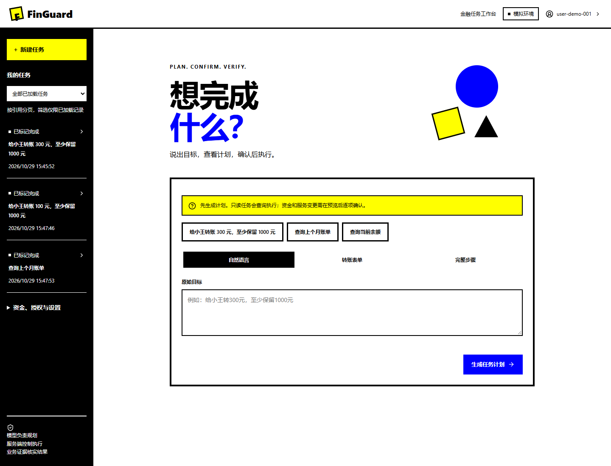
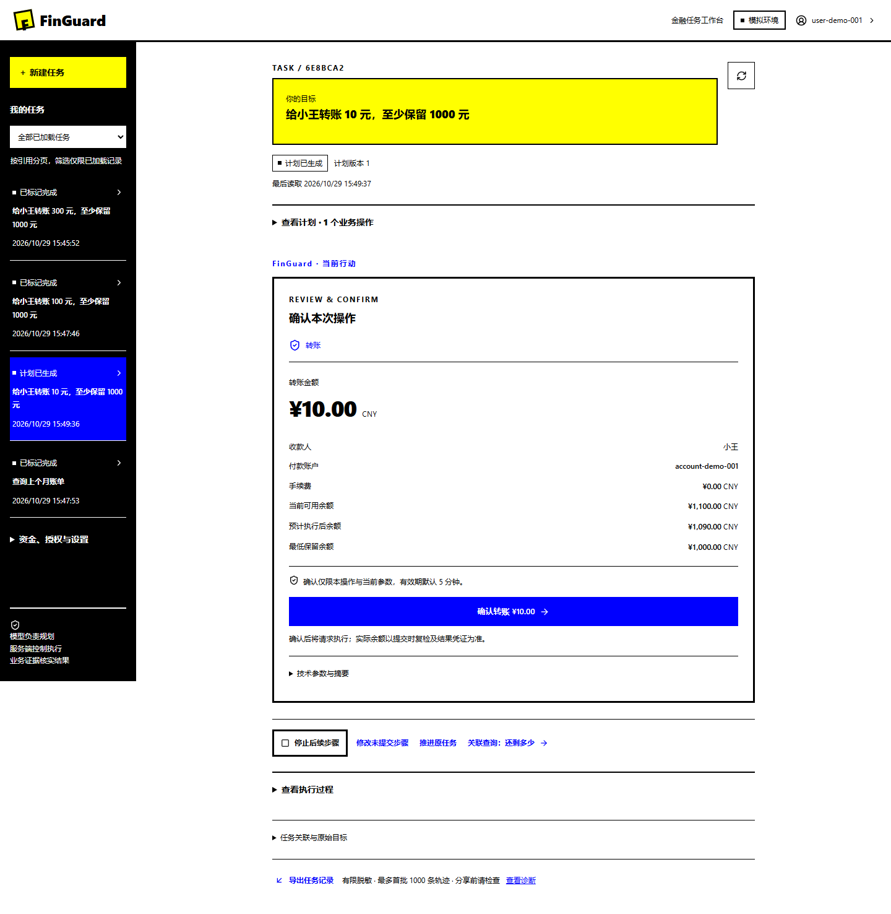
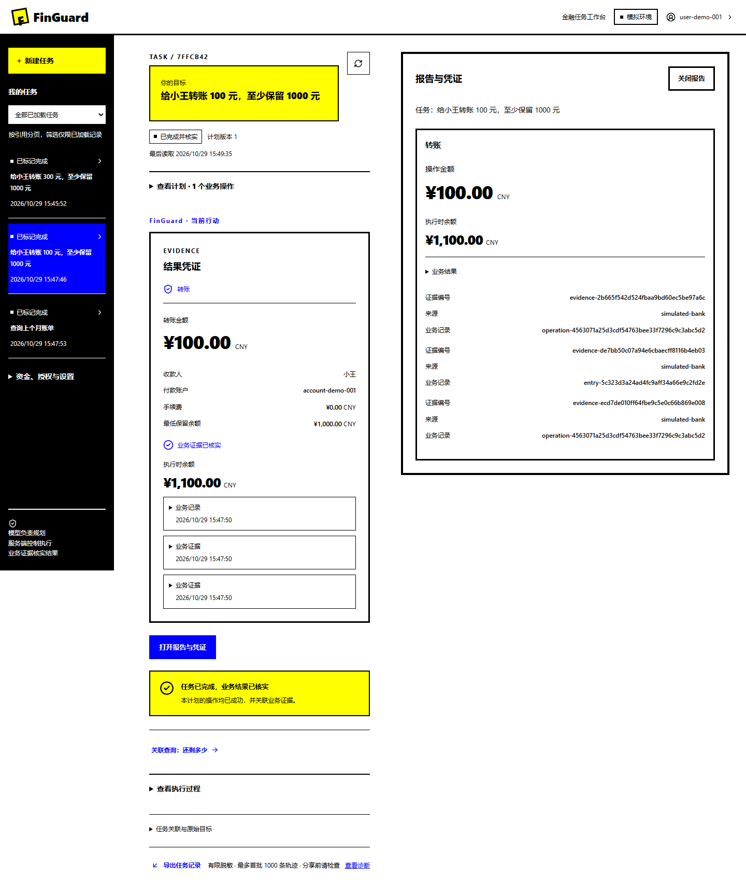
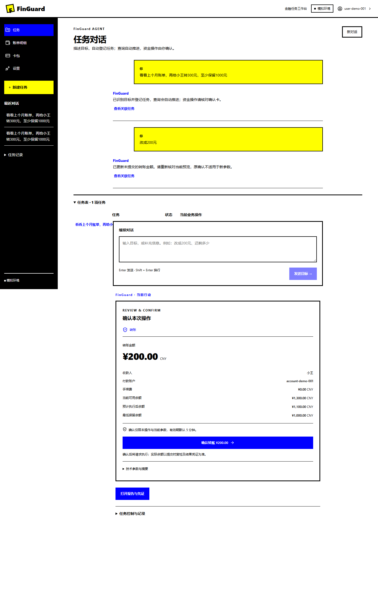
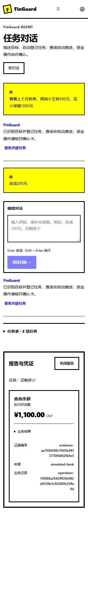
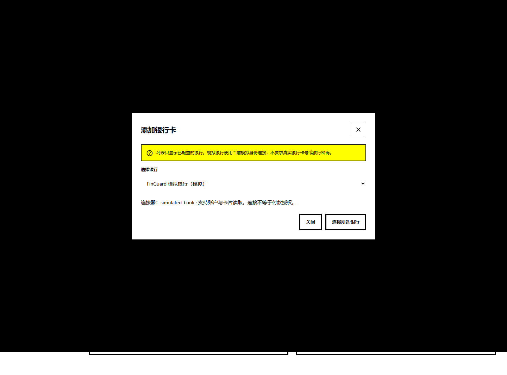
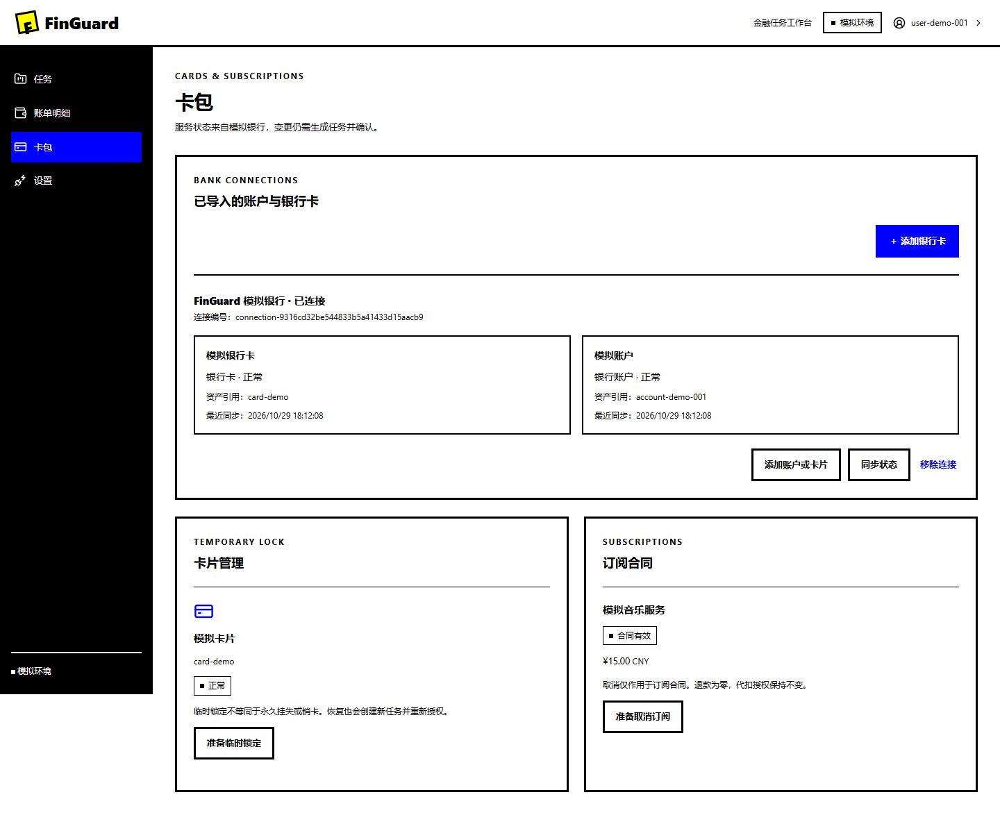

# 前端实现与验收

日期：2026 年 10 月 27 日。范围为[前端设计](frontend-design.md)的 F1 至 F3，在现有接口上实现。F4 的正式身份、额外验证、连接持久化和全局待办接口仍待开发。

## 实现范围

工作台包含任务列表、创建、转账表单、预览确认、轮询、停止、补全与重规划、凭证及导出。业务页面包含账户、自然月账单、产品、持仓、卡片、订阅和受限委托。开发区提供分页轨迹、计划差异、候选、回放、评估、发布与回退入口。

技术栈采用 React、TypeScript、Vite、React Router、TanStack Query、Zod 和 lossless-json，版本由 [package-lock.json](../frontend/package-lock.json) 固定。原生控件和 `dialog` 满足当前交互，未引入 Radix。动态接口使用人工核对的运行时契约，尚未自动生成 OpenAPI 类型。

内存会话按主体隔离缓存，退出或 401 后清理。旧会话的延迟响应不能覆盖新身份。金融写请求不自动重试；授权前复查版本、摘要、预览和身份验证策略。未知结果继续查询原任务，界面不提供原操作的重新付款按钮。

只有当前计划操作完成、任务核实标记成立且存在关联业务证据时，才展示已完成并核实。执行时余额与当前账户查询分开；历史预览不标成当前余额。预计余额由整数计算得出，不参与业务裁决。

## 自动检查

本机环境为 Windows、Node.js 24.12.0、Python 3.14 和本机 PostgreSQL。以下记录为本次实际执行结果：

| 检查 | 结果与范围 |
|---|---|
| 前端测试 | 27 项通过，覆盖金额、无损解析、状态、会话、重复点击、响应丢失、冲突、验证阻断、未知结果和弹窗焦点 |
| 前端格式与生产构建 | Prettier、TypeScript 和 Vite 检查通过 |
| 后端全量回归 | 317 项通过，包含新增的 2 项页面挂载检查 |
| 后端静态检查 | Ruff 代码与格式检查通过 |
| 远端持续集成 | 实现提交 `f444348` 的 [11 项检查全部通过](https://github.com/MagDaob/finguard/actions/runs/40512310752)，包含 Windows、Linux、数据库和三个容器的联动 |

测试命令见[前端入口](../frontend/README.md)和[测试说明](../tests/README.md)。持续集成新增 Windows、Linux 前端检查，并在容器任务中构建工作台、检查页面深链接和同源代理。远端结果以对应提交的 GitHub Actions 为准。

## 浏览器联调

联调使用 `scripts/frontend-qa.py` 建立的独立双服务、临时数据库命名空间和确定性规划器。项目演示数据保持独立。本轮没有访问真实银行，也没有调用付费模型。

| 场景 | 实际观察 |
|---|---|
| 转账确认 | 初始 1,500 元，确认转账 300 元后，执行时余额 1,200 元，显示关联证据 |
| 高金额限制与停止 | 1,001 元任务被服务端额外验证策略阻断；停止后保留未提交取消状态 |
| 自然月账单 | 2026 年 10 月区间截止于 11 月 1 日前；支出 55 元、退款 5 元、净支出 50 元 |
| 产品与赎回 | 产品风险状态、持仓来自接口；赎回 100 元后最终出现完成与到账证据；本次未截取到账前的短暂状态 |
| 卡片 | 临时锁定任务经确认后完成，显示锁定结果及证据 |
| 受限委托 | 建立 600 元委托，执行 100 元后占用 100 元、剩余 500 元；撤销后显示已撤销 |
| 配置校验 | 示例模型配置返回格式结果，界面明确提示未连接、未激活 |
| 个人诊断 | 普通主体读取自己任务的 10 条结构化事件，未显示评估发布入口 |
| 响应式与键盘 | 检查 1,440 px 桌面和 320 px 窄屏；任务与凭证无页面横向溢出；Escape 关闭弹窗后，焦点回到新建按钮 |

浏览器检查未穷尽全部业务组合。重复点击、创建响应丢失、版本冲突及未知结果保护另有组件测试；并发、恢复、到账依赖和权限由后端回归检查。本次未通过浏览器实际发布策略、回退策略或调用外部模型评估。

## 已知限制

复杂目标补全和多步骤重规划仍需完整 JSON，单笔转账可用表单。任务筛选只针对已加载数据，按引用分页；界面不提供全局待确认总数。长轨迹导出最多首批 1,000 条，诊断读取最多 100 页；输出应用有限脱敏，分享前仍需检查。

登录使用开发访问令牌。没有正式身份登录、续期、真实额外身份验证和跨页面关闭后的创建请求恢复。配置校验不保存或激活连接，不执行插件。开发区未调用的评估、发布与回退入口不能视为本次浏览器验收通过。

生产运行还需完成身份、安全、容量和部署验收。FastAPI TestClient 当前出现一项 HTTPX 适配弃用警告，未影响 317 项回归结果。

首轮远端 Windows 前端格式检查发现检出换行符差异，已通过前端目录的 Git 属性固定 LF，修复后的 11 项检查全部通过。隔离联调的停止文件入口也已实际验证：双服务正常退出，双库临时命名空间及会话令牌清理完成。

## Geometric Bold 改版验收

日期：2026 年 10 月 29 日。改版依据为[对话式任务与成果面板设计](frontend-redesign.md)。本次更新前端源码，未重建或验收 Windows EXE。

- `npm run format:check`、`npm test` 和 `npm run build` 均通过；组件检查共 31 项。
- 新增组件检查验证内嵌确认、证据出现后打开成果、关闭面板与焦点恢复。既有检查继续覆盖重复点击、预览冲突、高金额阻断、未知结果及原请求恢复。
- 通过 `scripts/frontend-qa.py` 的临时命名空间联调。浏览器完成任务创建、操作预览、明确确认、模拟银行记账与证据展示，验证报告打开关闭及窄屏导航。未调用付费模型。
- 确认页和成果视图在 1024、768、390 和 320 px 下未发现横向溢出，浏览器未捕获页面脚本错误。

本机数据库首次启动经历中断恢复，原配置中的连接无法用于本次联调。验收进程临时指定本机数据库，并使用脚本生成的隔离命名空间；没有修改开发配置和演示数据。

完整跨任务对话、额外身份验证服务及历史管理接口仍沿用原有待办。本次验证不替代桌面包和真实服务验收。

## 导航与设置整理验收

主导航已收拢为任务、账单明细、卡包、设置。设置内增加分类页和可持久保存的显示偏好。`npm run format:check`、`npm test`、`npm run build` 均通过，组件检查共 33 项，新增偏好持久化、恢复默认及异常数据读取检查。

本次浏览器使用模拟 HTTP 响应检查四个主入口、任务历史的显示范围、AI 与插件表单切换、偏好刷新恢复、移动端导航，以及 1024、390、320 px 的设置页面宽度。未发现横向溢出或页面脚本错误。本次未重新运行银行记账联调；业务接口与确认流程未改动。

AI 与插件接口的保存、启用能力仍待服务端提供，当前仅校验配置。桌面 EXE 尚未重新构建。

## 对话式任务与自动登记验收

日期：2026 年 10 月 29 日。已实现[对话式任务入口](conversations.md)，包含持久化消息、任务关联、自动推进查询、内嵌确认、自然语言金额修订及原消息恢复。

- 前端格式检查、生产构建通过；组件检查 35 项通过，新增原消息重试和待处理对话恢复检查。
- `pytest tests/backend/test_api.py tests/backend/test_understanding.py -q` 通过 58 项，覆盖原接口与新对话流程。随后补充对话互斥、权限和分页检查，6 项对话专项检查全部通过；进一步验证金额修订会撤销不再匹配的旧授权，单项重跑通过。
- 使用隔离双服务与确定性规划器完成组合目标、自动查询、原任务金额修订、明确确认、核实结果、关联余额追问与刷新后读取历史；未调用付费模型。
- 检查成果视图在 1024、768、390、320 px 下无横向溢出，浏览器未捕获页面脚本错误。

验收过程中，恢复工作后本机数据库未就绪，首次接口检查因连接超时失败；启动数据库并等待恢复完成后重新执行，以上结果为重跑结果。原开发配置与演示业务数据未修改。

桌面 EXE 未重建。对话支持范围、消息上限和恢复边界见[对话说明](conversations.md)。

## 卡包银行选择与导入验收

日期：2026 年 10 月 29 日。已实现[银行选择与导入](wallet-bank-connections.md)，服务端持久化连接与资产关联。当前目录只有已配置的 FinGuard 模拟银行，真实银行与外部 MCP 尚未接入。

前端组件检查 36 项通过；新增检查验证选择银行乙后请求绑定银行乙，以及仅导入勾选的服务端资产。后端 3 项卡包专项检查通过，覆盖连接与资产幂等、同步、移除、主体隔离、权限、不支持的银行及银行失败。首次检查时本机数据库未启动，启动并确认就绪后重跑通过。

生产构建与前端格式检查通过。使用 `scripts/frontend-qa.py` 的隔离模拟双服务，浏览器验证实际银行目录、选择银行、远程资源读取、两项资产导入、刷新重新登录后恢复、同步和移除。未调用外部真实银行或付费模型。1024、768、390 和 320 px 下未发现横向溢出或页面脚本错误。

