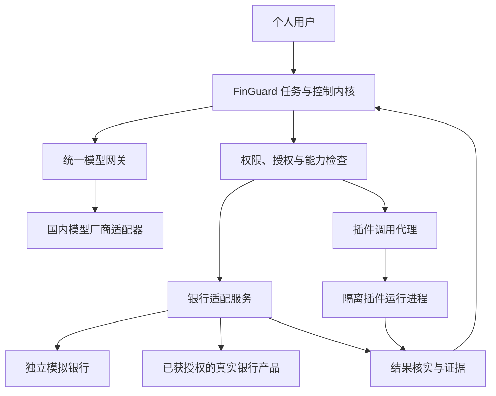

# 银行、模型与插件接入规划

状态：调研与设计草案，待实施。资料核对日期：2026 年 10 月 27 日。

本轮只形成规划并同步文档。用户已明确：以个人银行卡为主，企业接口仅作为技术参照。现有模拟银行、DeepSeek 接入和授权控制继续作为工程基线。

## 目标与现状

| 工作线 | 目标 | 当前状态 |
|---|---|---|
| 国内银行 | 按银行正式授权的产品接入个人账户能力，保留真实结果查询和证据 | 已有银行协议与独立模拟服务；尚未接入真实银行 |
| 国内模型 | 用户配置服务地址、API key 和模型，复用同一 Agent 控制流程 | 已接入 DeepSeek；另有项目自定义计划网关，尚非通用模型协议 |
| 软件插件 | 用户可以扩展工具、模型、报表和任务模板 | 工具集合和分发仍为静态实现；尚无用户插件安装与隔离运行能力 |

企业账户联调、商户收款或电子账户样例通过，均不能算作个人已有银行卡接入完成。每项能力分别标记为“文档已核实”“协议测试通过”“银行测试环境通过”或“生产验证通过”。

## 官方资料与接入判断

### 银行资料

| 官方来源 | 已核实内容 | 对本项目的用途与限制 |
|---|---|---|
| [兴业开放银行 API 接入规范](https://open.cibfintech.com/portal/doc_apijieru.html) | HTTPS、JSON 或表单请求、SM3WithSM2 签名、HTTP Basic 封装，以及响应验签和敏感字段加密 | 作为完整传输格式的首个参考；具体个人产品权限与业务字段仍需确认 |
| [兴业 API 接出规范](https://open.cibfintech.com/portal/doc_apijiechu.html)与[生产参数配置](https://open.cibfintech.com/portal/doc_getparams.html) | 回调有独立签名与加密规则；应用参数、公钥和可选客户端证书单独配置 | 回调不能直接复用请求签名逻辑；凭据类型不能只设计为 API key |
| [工行账户管理与信息服务](https://open.icbc.com.cn/icbc/apip/service_detail.html?service_id=P0015) | 官方目录列有余额、明细和账户信息能力，接入说明面向企业 | 参考查询能力与证据结构，不推定其可读取任意个人银行卡 |
| [工行账户合作服务](https://open.icbc.com.cn/icbc/apip/service_detail.html?service_id=P0024) | 产品清单、合作方接入、密钥及网络参数配置、状态查询与对账安排 | 用于区分合作账户、支付和查询场景；具体报文版本以银行提供的正式材料为准 |
| [招行 Open API 服务协议](https://openapi.cmbchina.com/serviceAgreement)与[一网通支付说明](https://cmbchina.com/personalbank/netpay/CmbPay.htm) | API 需按产品订阅；一网通支付面向持卡人向特约商户付款 | 商户支付接口不能当作个人任意转账接口，开放平台入口也不等于已获得调用权限 |

兴业接入规范的请求签名包含方法、路径、时间、随机数和规定顺序的业务参数。响应验签使用返回的原始字节；接出回调则采用另一套拼接规则。这些差异应封装在银行适配器内，不能用项目自己的 JSON 摘要替代银行签名规则。[请求规范](https://open.cibfintech.com/portal/doc_apijieru.html)、[回调规范](https://open.cibfintech.com/portal/doc_apijiechu.html)

本次没有找到足够材料，可证明任意个人开发者仅凭银行卡号和 API key，就能调用上述银行的全部个人账户功能。因此，首家生产银行按“可取得的个人产品正式文档、用户授权机制和测试权限”选择。公开传输规范可先用于实现和协议测试，不能据此声称个人账户已连通。

### 模型资料

下表是拟建立的厂商配置档案，不代表本项目已完成这些厂商的适配。使用按量 API 产品；地区、工作空间、模型和密钥归属须匹配。

| 厂商 | 已核实的基础地址或配置形式 | 设计关注点 |
|---|---|---|
| [DeepSeek](https://api-docs.deepseek.com/guides/multi_round_chat/) | `https://api.deepseek.com` | 保留现有接入和有界循环，逐步迁移到通用层 |
| [阿里云百炼](https://help.aliyun.com/zh/model-studio/qwen-api-via-openai-chat-completions) | 北京示例：`https://{WorkspaceId}.cn-beijing.maas.aliyuncs.com/compatible-mode/v1` | 支持工作空间与地域配置，不固定使用单一旧域名 |
| [火山方舟](https://docs.volcengine.com/docs/ark/integrate-third-party-tools?lang=en) | 按量接口：`https://ark.cn-beijing.volces.com/api/v3` | 按具体模型选择协议和能力；套餐与按量服务分别建档 |
| [智谱](https://docs.bigmodel.cn/cn/guide/develop/openai/introduction) | `https://open.bigmodel.cn/api/paas/v4/` | 兼容格式仍可能有字段差异 |
| [Kimi](https://www.kimi.com/help/kimi-api/api-troubleshooting) | 国内：`https://api.moonshot.cn/v1` | 国内、国际与 Kimi Code 的账号和密钥不能混用 |
| [百度千帆](https://cloud.baidu.com/doc/qianfan-api/s/ym9chdsy5) | 文档中的国内模型接口：`https://qianfan.baidubce.com/v2` | 模型调用支持 API key；平台管理接口另有鉴权方式 |
| [腾讯 TokenHub](https://cloud.tencent.com/document/product/1823/132252) | `https://tokenhub.tencentmaas.com/v1` | 新接入优先核实 TokenHub；[原混元文档](https://cloud.tencent.com/document/product/1729/111007)已有迁移说明 |

首期优先覆盖 Chat Completions 兼容协议。后续按实际需求增加 Responses、Messages 和厂商原生协议适配器。协议、厂商和模型分开记录；接口兼容不意味着所有模型都支持相同的工具调用、结构化输出或思考参数。

## 总体架构

模型只提出候选。银行和业务插件必须经过同一控制内核；连接配置、工具描述和模型输出均不能签发授权。模拟与真实环境显式选择，真实调用失败时不切回模拟结果。

后续按实现需要新增下列位置，本轮不创建空目录：

| 拟新增位置 | 职责 |
|---|---|
| `src/finguard/integrations/models/` | 通用模型协议、厂商配置和能力描述 |
| `services/bank-connectors/` | 各银行独立部署的报文、签名、认证、查询与回调适配 |
| `packages/plugin-contracts/` | 插件清单、调用上下文和结果契约 |
| `src/finguard/plugins/` | 安装记录、权限授予、调用代理与运行管理 |
| `plugins/examples/` | 只读分析和自定义报表等可运行示例 |

现有 `packages/bank-contracts/` 和 `services/bank-simulator/` 保留职责。优先扩展协议与版本，不把厂商 SDK 或模拟实现重新引入项目控制内核。

## 银行接入设计

### 能力与个人授权

新增 `BankConnection`，记录银行、产品、个人账户授权、连接版本、环境和凭据引用。账户及收款人使用受控映射，实际银行卡号由适配服务按需解析；模型只接收必要的别名和脱敏数据。

银行适配器提供查询、提交、状态核实、证据和可选用户确认动作。每条连接维护能力清单：账户查询、交易明细、个人转账、商户支付、锁卡、理财、回调、幂等、按客户业务编号查询及最低余额保证。

个人授权按具体产品接入银行提供的授权页面、SDK 或确认步骤。项目记录授权范围、有效期和撤销状态；操作确认与银行授权分别校验。涉及短信、设备确认或银行页面操作时，任务进入等待用户处理状态，不能用已有项目令牌代替银行确认。

首期目标为正式授权下的个人账户或明细只读闭环。若暂时取得不了个人账户接口，可先提供用户主动导入账单的只读插件。导入数据标明文件来源和时间，只用于分析，不能冒充实时余额或付款证据。

### 业务状态和证据

| 设计项 | 处理方式 |
|---|---|
| 连接绑定 | 操作绑定银行、产品、环境、账户映射版本和连接版本；切换银行或环境后重新生成预览与适用授权 |
| 参数与摘要 | 金额继续使用整数分；按具体接口转换为固定精度字符串。摘要加入连接身份、收款人及报价版本等关键参数 |
| 操作身份 | 保存项目操作编号、银行业务编号、银行流水号和每次通讯编号；通讯随机数与稳定业务编号分开 |
| 提交结果 | 区分银行受理、处理中、等待用户确认、成功、失败和未知；HTTP 200 或受理码不自动代表到账 |
| 超时与恢复 | 查询原业务编号，不自动重发付款，不跨银行重试同一付款 |
| 查询未找到 | 依据该产品的查询一致性和终态规则处理；不复制模拟器的失败栅栏能力 |
| 回调 | 按银行要求验签、校验时效并去重；触发权威查询和核实，不直接凭回调文字报告成功 |
| 证据 | 留存必要的银行业务记录引用、查询结果摘要、验证时间和完整性信息；可关联流水、回单与对账文件 |
| 不支持的约束 | 明确返回不支持或要求用户调整目标，不静默弱化原要求 |

最低保留余额需要单独评估。若真实银行不能提供相应的原子控制，查询余额后再转账仍会受其他渠道扣款影响。该适配器不能承诺与模拟银行相同的保证；严格目标应阻断执行并说明能力不足。

旧操作、旧授权和已完成事实采用版本化迁移。新规则只应用到按新契约创建的操作；恢复旧操作时仍使用其已绑定的连接和协议，不重新解释旧付款。

报文和签名实现优先采用银行官方 SDK，或与官方样例进行对照测试。若官方 SDK 要求 Java 等运行环境，可放在独立适配服务内，项目控制内核继续使用现有 Python 接口。

## 通用模型接口设计

### 用户配置

用户入口采用“API 地址＋API key＋模型选择”。已知厂商可自动填地址和协议；只有在服务支持时才读取模型列表，否则允许填写模型 ID。单凭地址和密钥无法确定要使用哪个模型。

拟新增连接配置如下，属于设计字段，尚未实现：

| 字段 | 用途 |
|---|---|
| `connection_ref`、`owner_ref` | 连接身份与用户归属 |
| `provider`、`protocol` | 厂商档案与调用协议分别记录 |
| `base_url`、`model_id` | 实际服务地址及明确的模型标识 |
| `credential_ref` | 密钥引用；管理接口只返回掩码 |
| `region`、`workspace_id` | 需要时配置地域和业务空间 |
| `capabilities`、`verified_at` | 已确认的工具、结构化输出、流式和思考能力 |
| `timeout`、`concurrency`、`budget` | 超时、并发、请求与 Token 预算 |
| `connection_version` | 配置变更与任务追溯 |

通用网关统一消息、工具调用、用量、结束原因、错误和流式事件。厂商扩展参数只进入对应适配器的白名单字段；不能覆盖目标地址、认证、控制工具或权限字段。

拟提供连接的创建、查询、更新、停用和探测接口，归入 `/v1/integrations/model-connections`。普通查询只返回非秘密配置与密钥状态。模型调用协议提供统一的完整响应与流式事件入口；厂商适配器负责实际报文，不向上层暴露不同 SDK 的对象。

### Agent 与密钥边界

现有简单任务单次规划和复杂任务有界循环复用同一网关。工具和结构化输出能力按具体模型验证；不支持所需能力时明确拒绝进入该规划模式，不伪造工具调用。

已有 DeepSeek 环境变量及自定义计划网关保留兼容迁移路径。旧自定义网关使用项目专有的计划协议，不能直接当成 Chat Completions 接口。协议测试须覆盖配置优先级，避免设置一个厂商却调用到另一个地址。

凭据按用户和连接隔离，保存在服务端受保护的凭据存储中；前端、插件、日志、报告和模型上下文不获得明文。密钥绑定已配置的目标主机，禁止重定向携带密钥。自定义地址需要管理员网络策略；内网或本机开发端点单独启用。

连接测试分为本地格式检查、可选模型列表查询和显式启用的付费推理检查。测试请求和真实评估有独立预算。统一控制重试，认证失败和余额不足不重试；可重试错误受总预算约束。重试不能触发重复业务执行，模型切换也不能改变已提交操作。

## 用户插件接口设计

### 扩展种类

| 类型 | 示例 | 控制边界 |
|---|---|---|
| 工具插件 | 账单分类、文件导入、个人预算分析 | 数据读取也检查用户归属和权限；默认只读 |
| 模型提供方 | 企业自建模型或新厂商协议 | 通过模型连接和能力契约，不接触银行凭据 |
| 银行适配器 | 新银行的正式授权产品 | 作为单独审查、部署的受信组件，不由普通工具插件自行升级 |
| 报表插件 | 自定义月报、导出模板 | 使用授权后的脱敏数据，保留来源 |
| 任务模板 | 自定义收支分析流程 | 只生成候选步骤，逐步执行既有权限与授权检查 |

插件清单声明名称、版本、宿主兼容范围、配置模式、工具模式、数据需求、资源上限和所申请的权限。权限声明只是申请，实际授予由服务端记录；新增或升级插件不会自动扩大权限。

当前静态 `ACTIONS` 需要迁移为受控工具注册表。插件工具使用命名空间和版本引用；计划、操作和证据记录实际使用的插件版本。插件不能覆盖核心工具名，不能自行把金融写入标成普通只读工具。

插件调用契约至少包含调用编号、插件与工具版本、任务及操作引用、参数、受限上下文引用和截止时间。结果返回结构化状态、数据、来源及错误。插件返回成功只是候选执行结果，宿主继续核实证据和任务目标。

### 安装和运行

安装流程为“导入包或服务声明→检查版本、依赖和完整性→查看配置与权限→显式启用”。首期使用固定版本和手动升级，提供停用、失败隔离及回退；不默认启用自动下载执行。

普通用户自定义代码在独立受限进程或容器中运行，限制文件、网络、CPU、内存、时长及输出大小。单独启动子进程本身不算安全隔离；实际权限必须由操作系统或容器策略落实。

宿主通过插件调用代理提供必要上下文和有范围的调用能力。插件不能读取项目数据库、凭据目录或银行签名密钥。新增业务写工具需要服务端登记业务类别、授权绑定和证据规则，全部调用仍经过控制内核。远程插件首期使用版本化 HTTP 契约，后续可增加外部工具协议桥接。

首个示例选择“用户账单导入与分类”或“自定义月报”，证明用户可以扩展功能并保持隔离。模型提示词、工具描述和插件返回内容均视为候选数据，不能改变权限、授权或核心执行规则。

## 实施阶段与验收

| 阶段 | 产物 | 通过标准 |
|---|---|---|
| M0：统一契约 | 银行能力、连接身份、模型协议、插件清单及版本迁移设计 | 明确模拟专属能力；插件和模型不能越过控制边界；现有功能有兼容路径 |
| M1：模型通用接入 | 通用网关、用户连接管理、DeepSeek 兼容迁移、厂商配置档案 | 同一 Agent 套件可以切换首批模型；测试覆盖坏密钥、超时、限流、工具调用和用户隔离 |
| M2：银行协议与只读样例 | 银行连接注册、传输适配、签名验签测试和个人授权流程 | 先通过官方样例或 SDK 测试；取得权限后完成至少一个个人账户或明细查询闭环 |
| M3：插件最小系统 | 注册表、清单、调用代理、隔离运行、启停与一个只读插件 | 自定义插件可用，越权请求被拒绝，停用或升级可追溯，不影响核心服务 |
| M4：真实银行写入 | 一个获准的个人业务产品，含银行确认、提交、查询和证据 | 银行测试环境先验证重复提交、超时、延迟回调和核实；生产验证另行明确账号、金额与范围 |
| M5：扩展与发布 | 更多厂商或银行、插件开发文档、打包与管理界面 | 按每个产品实际能力验收，形成支持矩阵和可复现记录 |

建议顺序为 M0 → M1 → M2 → M3 → M4。插件契约从 M0 预留，运行系统在 M3 落地。M2 的通用协议开发可以先行；真实个人接口联调以取得对应产品权限为条件，不把等待银行材料算作代码实现完成。

首批模型建议选择现有 DeepSeek，再加入百炼、智谱或 Kimi 中可提供按量密钥的两家。其他厂商先完成配置档案和模拟协议测试，取得真实凭据后逐家验收，不能把“配置了地址”写成“已接入”。

## 验证与下一步输入

现有 [216 项测试和隔离验收](service-isolation.md)为历史基线，本轮没有重新执行功能测试。实施时保留这些行为检查，再新增银行协议、模型兼容、插件越权、凭据隔离和升级回退测试。正式网络测试与普通持续集成分开，使用独立凭据和数据。

银行准入测试覆盖签名与验签、时钟与随机数、分页、金额精度、账号归属、授权到期、状态映射、重复回调、查询延迟和未核实结果。插件测试覆盖伪造只读声明、越权数据访问、访问凭据文件、未批准网络、执行超时及版本不兼容。

实施真实银行联调前，需要确定首家目标银行和个人产品，并取得该产品的正式接口版本、测试权限及用户授权说明。若首家银行没有开放目标能力，可保留相应工具为不支持，并继续完成模型与只读插件工作。

本阶段不承诺所有银行都提供个人任意转账、锁卡或理财接口。项目交付按“通用框架可扩展、已接入产品逐项可核实”的方式验收。
