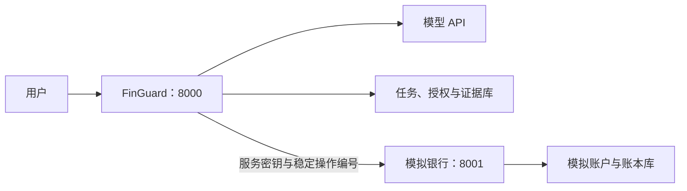

# 项目与模拟银行隔离

截至 2026 年 10 月 27 日，项目本体通过认证 HTTP 接口访问独立模拟银行。双方分开源码、运行环境、配置、进程和数据库凭据。任务、授权和证据仍由 FinGuard 管理。

## 目录与职责

| 目录 | 内容 | 运行边界 |
|---|---|---|
| [src/finguard/](../src/finguard/) | 项目本体、Agent、控制、授权、任务和证据 | 默认端口 `8000` |
| [services/bank-simulator/](../services/bank-simulator/) | 模拟账户、账本、产品、服务、结算、故障和独立迁移 | 默认端口 `8001` |
| [packages/bank-contracts/](../packages/bank-contracts/) | 参数模式、整数金额、摘要及错误契约 | 无应用、模拟器或数据库依赖 |
| `runtime/backend/.venv/` | 项目本体的运行环境 | 不安装模拟器包 |
| `services/bank-simulator/.venv/` | 模拟服务的运行环境 | 不安装项目本体 |
| `.venv/` | 仓库开发和回归测试环境 | 显式包含两个包，供离线验证 |



两边只依赖中立契约包。项目的在线接口、恢复进程和账本查询都通过 `backend/bank.py` 客户端访问模拟服务。模拟银行不读取 DeepSeek 密钥，也不签发用户操作授权。

## 本机配置与启动

根目录 `.env` 使用 `FINGUARD_` 配置；模拟目录的 `.env` 使用 `SIMBANK_` 配置。两个进程分别以自己的目录启动，配置文件和运行产物均被 Git 忽略。

| 配置位置 | 数据库 | 其他凭据 |
|---|---|---|
| 根目录 `.env` | `FINGUARD_DATABASE_URL`，仅连接项目数据库 | 模型密钥和 `FINGUARD_BANK_API_KEY` |
| 模拟目录 `.env` | `SIMBANK_DATABASE_URL`，仅连接模拟数据库 | `SIMBANK_API_KEY`，与服务调用密钥一致 |

Windows 本机使用以下命令。首次初始化需要本机 PostgreSQL 管理权限；内置下载脚本建立的实例具备此权限。已有服务应先执行停止命令。

```powershell
uv sync --locked --group dev
.\scripts\local-postgres.ps1 start -Download
.\scripts\local-services.ps1 stop
uv run --locked python scripts/isolate-local.py
.\scripts\sync-services.ps1
uv run --locked finguard seed-demo
.\scripts\local-services.ps1 start
```

初始化助手创建 `finguard_app` 和 `finguard_simulator` 两个数据库及独立普通账号，并撤销数据库的公共连接权限。双方账号无法连接对方数据库。本机共用 PostgreSQL 进程；Compose 使用两个 PostgreSQL 容器和两个数据卷。

若原库包含模拟业务，助手复制项目和银行记录，保留操作编号、余额、流水和令牌摘要。原库保留，助手不清空或覆盖目标数据。迁移凭据和进度保存在忽略的 `artifacts/service-isolation/`。外部数据库部署应自行建立独立账号和数据库，再按两个配置示例填写连接。

```powershell
.\scripts\local-services.ps1 status
.\scripts\local-services.ps1 stop
```

服务分别提供 `http://127.0.0.1:8000/docs` 和 `http://127.0.0.1:8001/docs`。模拟业务接口只接受服务密钥；用户继续访问项目接口。模拟服务没有远程数据重置、故障注入或任意方法调用入口。

## 升级与恢复

保留原有 `001-initial.sql`。新增 `002-bank-service-boundary.sql` 将项目命名空间中的旧银行表移出在线范围：空表删除；有记录的旧表移入 `legacy_bank_<命名空间摘要>`，保留数据。归档不是在线银行数据源。

从旧原型升级时，先停止进程并运行复制助手，再启动新服务。助手支持尚未迁移的旧表；已执行归档迁移的旧库应先核实归档位置，再单独导出。禁止把空演示库当作旧账本恢复结果。

提交超时和响应丢失继续使用原操作编号查询。客户端不自动重试提交，也不在故障时回退到本地模拟器。银行停机时项目的就绪检查失败，存活接口仍可响应；未核实的操作不能报告成功。

## 开发与验收

离线回放、故障注入和跨库不变量检查移至模拟包的测试模块，只有显式安装开发依赖才可使用。旧回归套件仍使用随机同库夹具；双进程联调使用两个随机命名空间。在线运行不使用这些测试夹具。正式环境默认关闭 HTTP 评估入口。

```powershell
uv run --locked pytest -q
uv run --locked ruff check .
uv run --locked ruff format --check .
uv build --all --no-sources
```

隔离验收包括：服务认证、参数校验、提交超时无重试、旧账本保留、双进程 HTTP 通信、响应丢失后重启恢复，以及单笔付款只生成一笔扣款。容器检查分别验证应用镜像没有模拟器包、模拟镜像没有应用包。
